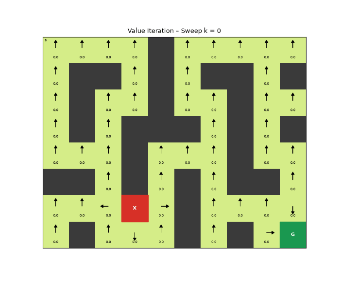
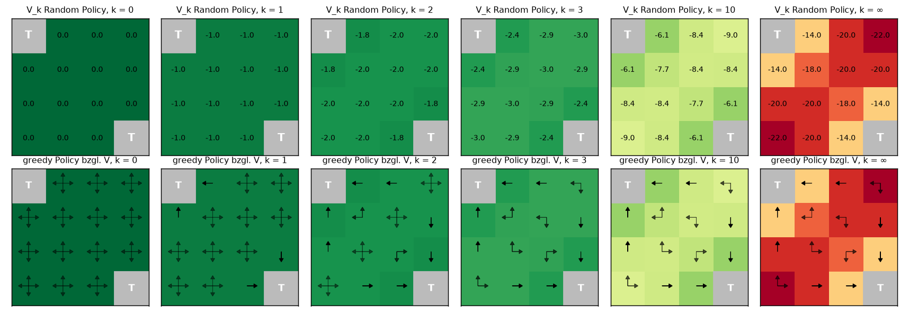
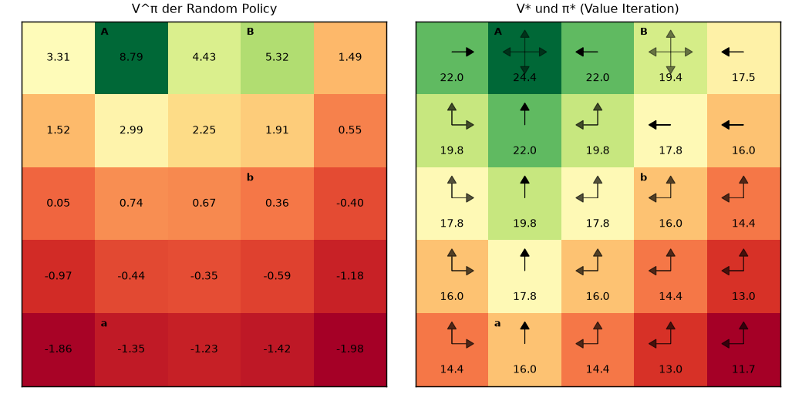
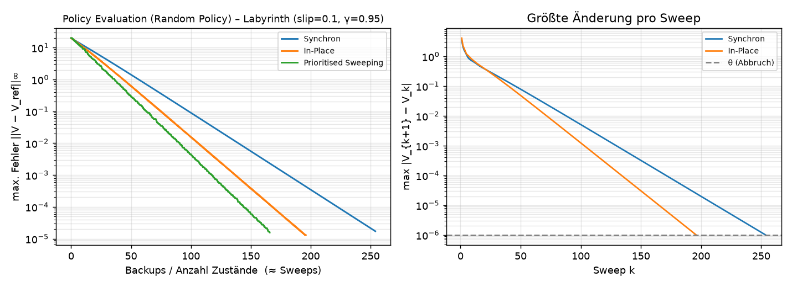
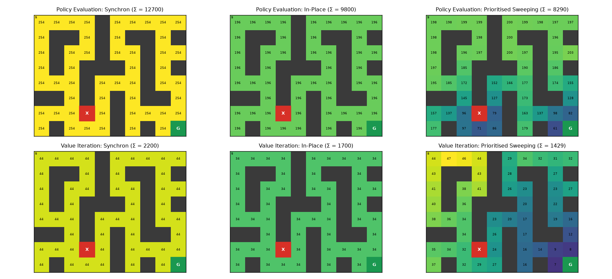
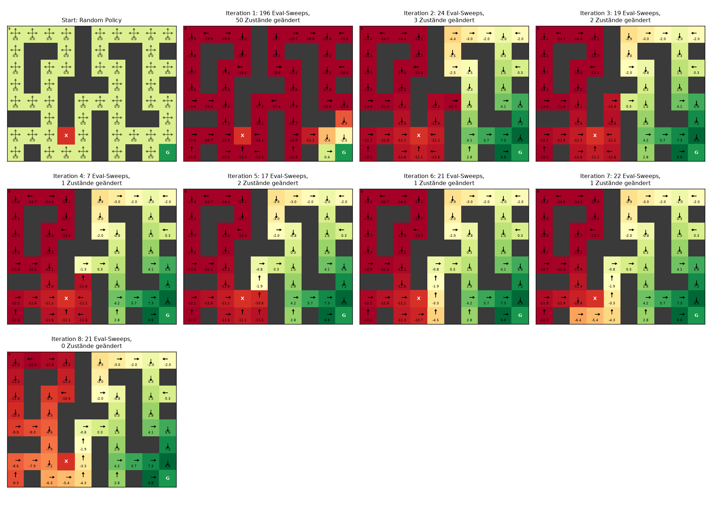
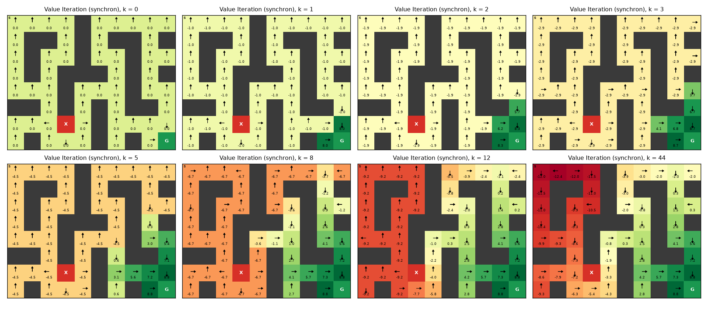
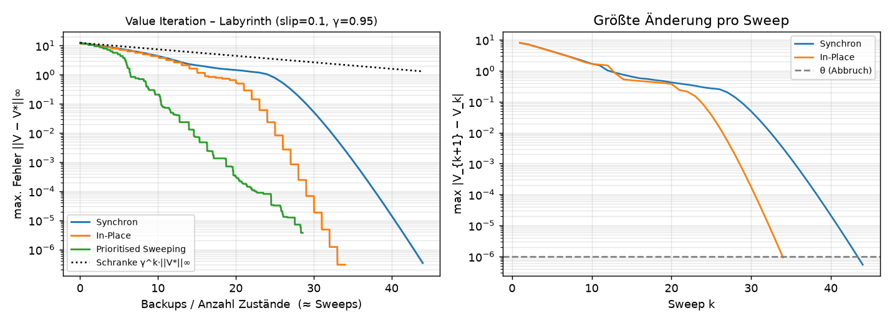
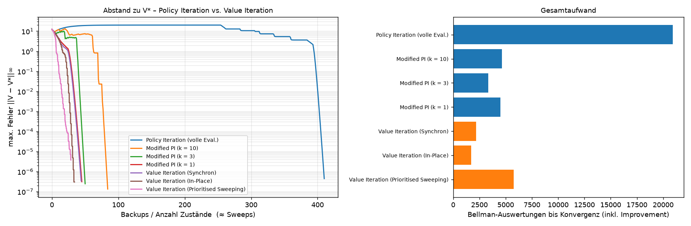
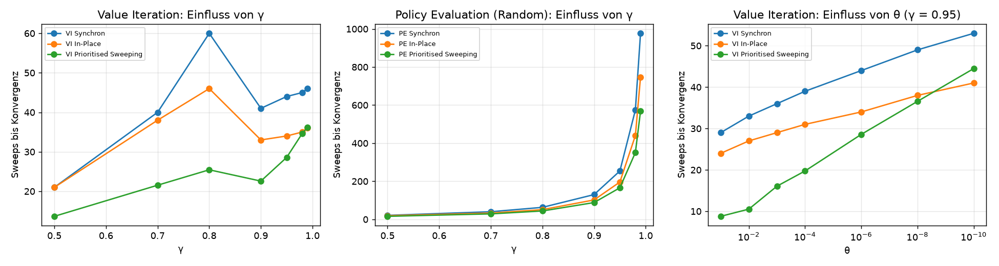

# Dynamic Programming auf Gitterwelten – Policy Evaluation, Policy Iteration, Value Iteration

Implementierung und Visualisierung der Verfahren aus
*David Silver, Lecture 3 – Planning by Dynamic Programming* und
*Pareigis, RL02 – Dynamic Programming* (HAW Hamburg).

Alles läuft auf einer Gitterwelt, deren Modell (Übergänge `P` und Belohnungen `R`) **vollständig
bekannt** ist. Das ist die Grundvoraussetzung für Dynamic Programming.



## Schnellstart

```bash
python3 -m venv .venv && source .venv/bin/activate
pip install -r requirements.txt
python -m pytest                    # prüft u. a. die Zahlen aus den Folien
python -m experiments.run_all       # erzeugt figures/*.png und results/summary.md (~10 s)
```

## Die Idee in einfachen Worten

* Jedes Feld bekommt eine Zahl **V(s)**: *„Wie gut ist es, hier zu stehen?“*
* Diese Zahl berechnet man aus den Nachbarn: **Belohnung für den Schritt + γ · Wert des Nachbarfelds**.
  Das ist die Bellman-Gleichung. Man wendet sie immer wieder an, bis sich nichts mehr ändert.
* **γ** (Discount) < 1 heißt: spätere Belohnungen zählen weniger.

| Problem | Bellman-Gleichung | Algorithmus | Update |
|---|---|---|---|
| Prediction: *Wie gut ist π?* | Erwartungsgleichung | Policy Evaluation | `V(s) ← Σ_a π(a\|s) (R(s,a) + γ Σ_s' P(s'\|s,a) V(s'))` |
| Control | Erwartung + greedy | Policy Iteration | evaluieren → `π(s) ← argmax_a q(s,a)` → wiederholen |
| Control | Optimalitätsgleichung | Value Iteration | `V(s) ← max_a (R(s,a) + γ Σ_s' P(s'\|s,a) V(s'))` |

Value Iteration ist Policy Iteration, bei der die Evaluation nach **einem** Sweep abgebrochen wird. Es gibt
keine explizite Policy, π* wird am Ende greedy aus V* abgelesen.
**Konvergenz:** Beide Backup-Operatoren sind γ-Kontraktionen in der ∞-Norm. Deshalb gibt es genau einen
Fixpunkt, und der Fehler schrumpft pro Sweep mindestens um den Faktor γ.

### Drei Arten, die Updates auszuführen

| Verfahren | Idee | Speicher |
|---|---|---|
| **Synchron** | Jeder Sweep liest nur Werte aus dem *vorigen* Sweep | 2 Kopien von V |
| **In-Place** | Neue Werte werden im selben Sweep sofort weiterverwendet | 1 Kopie |
| **Prioritised Sweeping** | Immer den Zustand mit dem größten Bellman-Fehler `\|max_a(...) − V(s)\|` zuerst; danach nur die Fehler seiner **Vorgänger** neu berechnen (Priority Queue) | 1 Kopie + Queue |

Alle drei Schemata sind einmal implementiert (`rldp/sweeps.py`) und werden sowohl für Policy Evaluation
(Erwartungs-Backup) als auch für Value Iteration (Optimalitäts-Backup) benutzt.

## Code-Struktur

```
rldp/
  gridworld.py        GridWorld: ASCII-Karte -> MDP (P[s,a,s'], R[s,a]), Wände, Ziel, Falle,
                      Teleporter, rutschiger Boden (slip), env.step() zum Simulieren
  maps.py             Small Gridworld 4x4 (Silver), Sutton 5x5 (A/B, Pareigis-Folien), Labyrinth
  policy.py           Policy als Tabelle π(a|s): uniform, deterministisch, greedy, P^π, R^π
  sweeps.py           Synchron / In-Place / Prioritised Sweeping + Messdaten (RunResult)
  evaluation.py       policy_evaluation(...), exact_policy_evaluation (lineares Gleichungssystem)
  improvement.py      q_values, greedy_policy, policy_improvement, policy_iteration (auch "modified")
  value_iteration.py  value_iteration(...)
  plotting.py         Heatmaps mit Policy-Pfeilen, Konvergenzkurven, GIF
experiments/run_all.py  alle Experimente/Abbildungen
tests/test_dp.py        Abgleich mit den Folienwerten, PI = VI, Modified PI, Prioritised Sweeping
```

Minimalbeispiel:

```python
from rldp import Policy, policy_evaluation, policy_iteration, value_iteration
from rldp.maps import maze

env = maze(slip=0.1, gamma=0.95)
random = Policy.uniform(env.n_states, env.n_actions)

pe = policy_evaluation(env, random, method="in_place", theta=1e-6)     # V^π
pi = policy_iteration(env, eval_method="synchronous")                  # π*, V*
vi = value_iteration(env, method="prioritized", theta=1e-6)            # V*, vi.policy = π*
print(pe.sweeps, pi.iterations, vi.total_backups)
```

Eigene Karten: `GridWorld(["S..#", "...G"], gamma=0.9, step_reward=-1, goal_reward=10, slip=0.2)`.

## Ergebnisse

Alle Zahlen: [`results/summary.md`](results/summary.md). Das Labyrinth hat 50 nicht-terminale Zustände,
γ = 0.95, slip = 0.1, θ = 10⁻⁶.

### 1. Folienbeispiel Small Gridworld (Random Policy, γ = 1)

Werte nach k Sweeps und die greedy Policy dazu. Nach k = 3 ist die greedy Policy schon optimal,
wie auf den Folien. Die Tests prüfen genau die Werte −1.75 / −2.4 / −14 / −18 / −20 / −22.



### 2. Sutton-5x5-Gitter (Pareigis-Folie „Generalised Policy Iteration“)

Links V der Random Policy (3.3, 8.8, 4.4, 5.3, 1.5), rechts V* und π*.



### 3. Policy Evaluation: Synchron vs. In-Place vs. Prioritised Sweeping



| Verfahren | Sweeps | Backups | Bellman-Auswertungen |
|---|---|---|---|
| Synchron | 254 | 12 700 | 12 700 |
| In-Place | 196 | 9 800 | 9 800 |
| Prioritised Sweeping | 166 | 8 290 | 33 395 |

* Der Fehler fällt **linear im log-Plot**, so wie es die Kontraktion vorhersagt.
* In-Place ist schneller als synchron, weil frische Werte sofort weiterverwendet werden.
* Prioritised Sweeping braucht die wenigsten Backups. Dafür kostet das Nachrechnen der Bellman-Fehler
  der Vorgänger zusätzlich, was in der Spalte „Bellman-Auswertungen“ sichtbar wird. Es lohnt sich vor allem,
  wenn sich nur Teile des Zustandsraums ändern.

### 4. Wo wird gerechnet? (Backups pro Zustand)



Synchron und In-Place aktualisieren jeden Zustand gleich oft. Prioritised Sweeping konzentriert die Arbeit
dort, wo sich etwas ändert. Bei Value Iteration ist das der Bereich weit weg vom Ziel, in dem die
Information zuletzt ankommt. Nahe am Ziel reichen wenige Updates.

### 5. Policy Iteration Schritt für Schritt



Die erste Evaluation der Random Policy ist teuer (196 Sweeps). Danach ändern sich pro Iteration nur noch
wenige Zustände, und die Evaluation startet warm vom vorigen V. Nach 8 Iterationen ist die Policy stabil.

### 6. Value Iteration: Die Werte breiten sich wie eine Welle vom Ziel aus





Die gepunktete Linie ist die theoretische Schranke `γ^k · ||V0 − V*||∞`. In der Praxis konvergiert
Value Iteration hier deutlich schneller.

### 7. Policy Iteration vs. Value Iteration



| Verfahren | Iterationen | Backups (Eval.) | Bellman-Auswertungen gesamt |
|---|---|---|---|
| Policy Iteration (volle Eval.) | 8 | 20 500 | 20 900 |
| Modified PI (k = 10) | 9 | 4 200 | 4 650 |
| Modified PI (k = 3) | 17 | 2 500 | 3 350 |
| Modified PI (k = 1) | 45 | 2 250 | 4 500 |
| Value Iteration (Synchron) | 44 Sweeps | 2 200 | 2 200 |
| Value Iteration (In-Place) | 34 Sweeps | 1 700 | 1 700 |
| Value Iteration (Prioritised) | 28.6 Sweeps | 1 429 | 5 777 |

* Policy Iteration braucht **wenige Iterationen**, aber jede vollständige Evaluation ist teuer. Am meisten
  kostet die der schlechten Startpolicy.
* Die Evaluation früh abzubrechen (Modified PI, *Generalised Policy Iteration*) spart sehr viel. Bei k = 1
  ist man praktisch bei Value Iteration.
* Alle Verfahren landen bei derselben optimalen Policy.

### 8. Parameter: γ und θ



* **Policy Evaluation der Random Policy** wird mit γ → 1 sehr langsam (~1/(1−γ)). Die Random Policy irrt
  lange umher, bevor sie das Ziel findet.
* **Value Iteration** hängt hier kaum von γ ab. Die optimale Policy erreicht das Ziel in wenigen Schritten,
  deshalb ist die effektive Kontraktion viel stärker als γ.
* Ein kleineres **θ** kostet bei synchron/in-place nur logarithmisch mehr Sweeps (lineare Konvergenz).

## Anmerkungen zu den Folien (Pareigis RL02)

* Der Code auf der Folie „Policy evaluation – synchronous“ schreibt `V[ix,iy] = value` direkt zurück. Das ist
  in Wahrheit **in-place**. Synchron braucht eine Kopie von V (siehe `run_synchronous`).
* `policy_improvement` gibt laut Kommentar `True` zurück, wenn sich die Policy **geändert** hat. Die Schleife
  `if policy_improvement(V): break` bricht dann aber genau im falschen Fall ab. Hier liefert
  `policy_improvement` die Anzahl geänderter Zustände, und Policy Iteration stoppt bei 0.
* Bei Gleichstand behält `policy_improvement` die alte Aktion. Sonst kann Policy Iteration zwischen gleich
  guten Aktionen endlos hin- und herspringen.
* In der Bellman-Optimalitätsgleichung auf Folie 4 muss rechts `V*` stehen, nicht `V_π`.

## Quellen

* D. Silver: *Lecture 3 – Planning by Dynamic Programming*, UCL RL Course
* S. Pareigis: *RL02 Dynamic Programming*, HAW Hamburg
* R. Sutton, A. Barto: *Reinforcement Learning – An Introduction*, Kap. 3–4
