# Lernpfad: Dynamic Programming im Reinforcement Learning

> **Ziel:** Am Ende verstehst du **Policy Evaluation, Policy Improvement, Policy Iteration und Value
> Iteration**. Dazu die drei Rechenarten **synchron, in-place und Prioritised Sweeping**, und warum
> das alles funktioniert.
> Jedes Kapitel hat dieselbe Form: **Idee in einem Satz → Bild → Erklärung → wo es im Code steht**.

---

## 0. Das große Bild

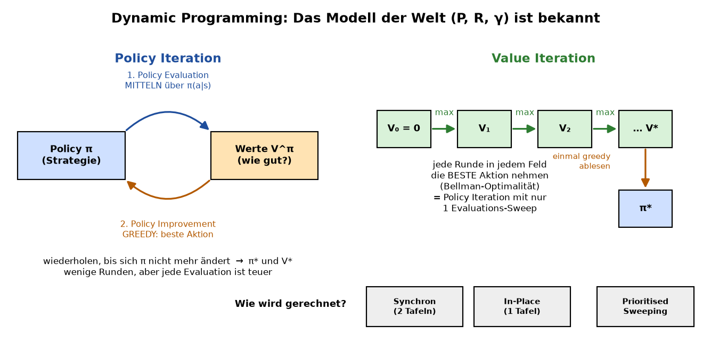

**In einem Satz:** Wir kennen die Regeln eines Spiels genau und rechnen aus, wie gut jedes Feld ist
und was man dort am besten tut.

Es gibt zwei Fragen:

| Frage | Name | Antwort liefert |
|---|---|---|
| „Wie gut ist **meine** Strategie?“ | **Prediction** | Policy Evaluation |
| „Was ist die **beste** Strategie?“ | **Control** | Policy Iteration oder Value Iteration |

„Dynamic Programming“ heißt: Ein großes Problem (der ganze Weg zum Ziel) wird in kleine Teilprobleme
zerlegt (nur **ein** Schritt und dann „wie gut ist es danach?“). Die Teilergebnisse werden in einer
Tabelle **V** gespeichert und immer wieder benutzt.

---

## 1. Die Welt: ein Gitter

**In einem Satz:** Ein Agent läuft über ein Gitter. Jeder Schritt kostet etwas, am Ziel gibt es einen Bonus.

```
S...#.....      S = Start         # = Wand
.##.#.##.#      G = Ziel (Bonus)  X = Falle (Strafe)
.#..#..#..      jeder Schritt: −1
...             Aktionen: ↑ → ↓ ←
```

| Begriff | Bedeutung | Im Code |
|---|---|---|
| Zustand `s` | ein Feld | `env.states[s]` = (Zeile, Spalte) |
| Aktion `a` | ↑ → ↓ ← | `0, 1, 2, 3` |
| Übergang `P[s, a, s']` | Wahrscheinlichkeit, mit Aktion `a` von `s` nach `s'` zu kommen | `env.P` |
| Belohnung `R[s, a]` | was man im Schnitt für die Aktion bekommt | `env.R` |
| Discount `γ` | wie viel „später“ noch zählt (0.9 = 10 % weniger pro Schritt) | `env.gamma` |
| `slip` | rutschiger Boden: Manchmal geht man zur Seite statt geradeaus | `maze(slip=0.1)` |

**Wichtig:** Dynamic Programming **kennt** `P` und `R` vollständig. Es muss nichts ausprobieren.
Genau das unterscheidet es von späteren Verfahren wie Q-Learning.

📄 Code: [`rldp/gridworld.py`](../rldp/gridworld.py) → `_build_model()`

---

## 2. Was ist eine Policy?

**In einem Satz:** Die Policy π ist die Strategie. Sie sagt für jedes Feld, welche Aktion man wählt.

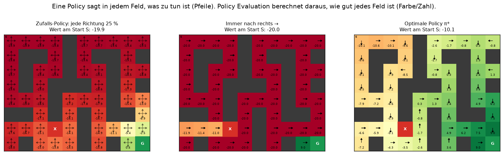

Gespeichert wird sie als Tabelle `π(a|s)` = Wahrscheinlichkeit für Aktion `a` in Feld `s`:

```
            ↑     →     ↓     ←
Zufall:   0.25  0.25  0.25  0.25     (links im Bild: Pfeile in alle Richtungen)
Rechts:   0.00  1.00  0.00  0.00     (Mitte: immer →)
```

Jede Policy hat ihre eigenen Werte. Am Start S gilt:
**Zufall −19.9**, **immer rechts −20.0** (läuft nur gegen die Wand), **optimal −10.1**.
Die optimale Policy π* ist die, bei der **jedes** Feld den höchsten Wert hat.

📄 Code: [`rldp/policy.py`](../rldp/policy.py) → `Policy.uniform`, `Policy.deterministic`, `Policy.greedy`

---

## 3. Der Wert V(s) und die Bellman-Gleichung

**In einem Satz:** Der Wert eines Feldes ist die Belohnung für den nächsten Schritt plus γ mal der Wert
des nächsten Feldes.

Alltagsbeispiel: *„Wie lange brauche ich noch nach Hause?“*
= *„Zeit bis zur nächsten Kreuzung“* + *„wie lange von dort nach Hause“*.
Man muss nicht den ganzen Weg kennen, sondern nur den nächsten Schritt und die Antwort des Nachbarn.
So arbeitet auch Dijkstra bei der Suche nach dem kürzesten Weg (siehe Pareigis-Folien).

Es gibt zwei Versionen:

| | Formel | in Worten |
|---|---|---|
| **Erwartung** (feste Policy π) | `V(s) = Σ_a π(a\|s) · [ R(s,a) + γ · Σ_s' P(s'\|s,a) · V(s') ]` | **Mittelwert** über die Aktionen, die π wählt |
| **Optimalität** (beste Policy) | `V*(s) = max_a [ R(s,a) + γ · Σ_s' P(s'\|s,a) · V*(s') ]` | die **beste** Aktion nehmen |

Der Teil in der eckigen Klammer heißt **q(s, a)**: „Wie gut ist es, in `s` die Aktion `a` zu machen?“

📄 Code: [`rldp/improvement.py`](../rldp/improvement.py) → `q_values`

---

## 4. Ein einziges Backup, vorgerechnet

**In einem Satz:** Ein „Backup“ berechnet den neuen Wert **eines** Feldes aus den Werten seiner Nachbarn.

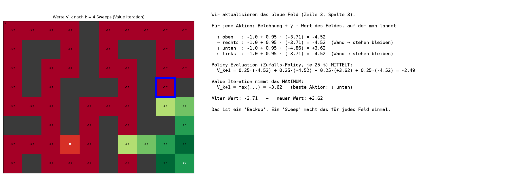

Hier sieht man den ganzen Unterschied:

* **Policy Evaluation (Zufalls-Policy)** **mittelt** die vier q-Werte zu **−2.49**.
* **Value Iteration** nimmt das **Maximum**: **+3.62**, denn „unten“ führt zum Ziel.

Ein **Sweep** bedeutet: Jedes Feld bekommt einmal ein Backup.

📄 Code: [`rldp/evaluation.py`](../rldp/evaluation.py) → `expectation_backups`,
[`rldp/value_iteration.py`](../rldp/value_iteration.py) → `optimality_backups`

---

## 5. Policy Evaluation: „Wie gut ist meine Policy?“

**In einem Satz:** Starte mit V = 0 und wende die Bellman-**Erwartungs**gleichung so lange auf alle
Felder an, bis sich nichts mehr ändert.

```python
V = 0 überall
wiederhole:
    für jedes Feld s:
        V_neu(s) = Σ_a π(a|s) · ( R(s,a) + γ · Σ_s' P(s'|s,a) · V(s') )
bis max |V_neu − V| < θ
```

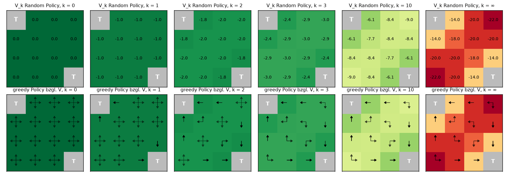

Das ist das Beispiel aus beiden Foliensätzen (4×4-Gitter, Zufalls-Policy, −1 pro Schritt):

* **k = 1:** überall −1, denn ein Schritt kostet −1.
* **k = 2:** neben dem Ausgang −1.75, weil `0.25·(−1+0) + 0.75·(−1−1) = −1.75`.
* **k = ∞:** −14, −18, −20, −22. Das ist minus die Anzahl der Schritte, die die Zufalls-Policy
  im Schnitt bis zum Ausgang braucht.
* **Untere Reihe:** Wer **greedy** bezüglich V handelt, hat schon ab **k = 3** die optimale Policy,
  obwohl V noch lange nicht fertig ist. Das ist die Grundidee von Policy Iteration.

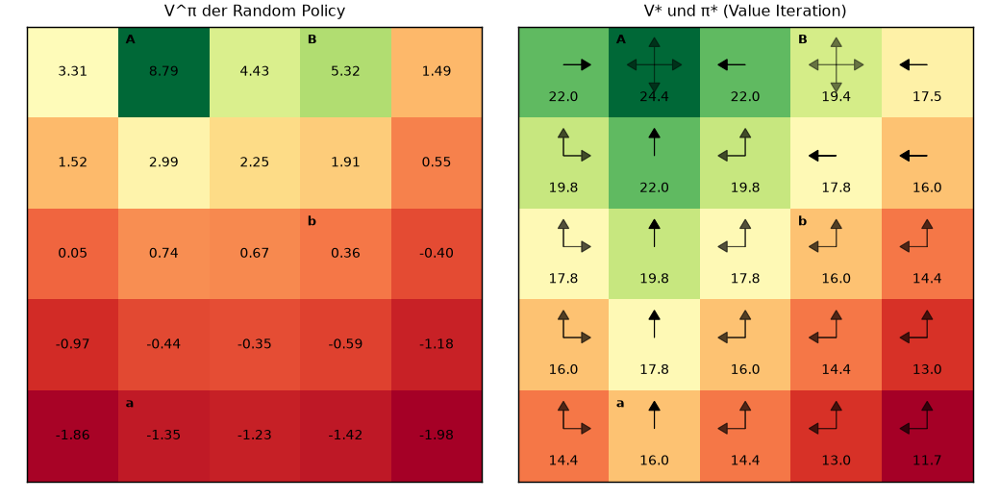

📄 Code: [`rldp/evaluation.py`](../rldp/evaluation.py) → `policy_evaluation(env, policy, method, theta)`

---

## 6. Drei Arten, einen Sweep zu rechnen

### 6a. Synchron vs. In-Place

**In einem Satz:** *Synchron* rechnet mit zwei Tafeln (alt und neu). *In-place* rechnet mit einer
Tafel und benutzt frische Werte sofort.

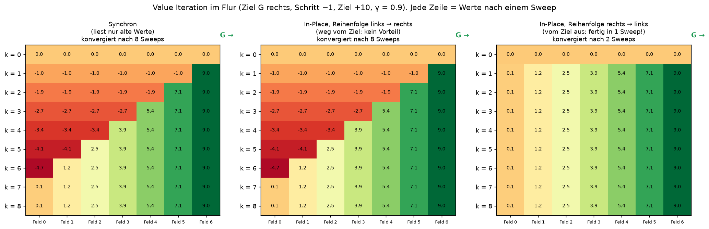

Im Flur sieht man es sehr deutlich. Jede Zeile zeigt die Werte nach einem Sweep.

* **Synchron:** Die Information vom Ziel wandert pro Sweep genau **ein Feld** nach links.
  Bei 7 Feldern braucht es 7 Sweeps und einen Kontroll-Sweep, der zeigt, dass sich nichts mehr ändert.
* **In-place von links nach rechts:** **Kein Vorteil.** Wenn Feld 0 dran ist, weiß Feld 1 noch nichts Neues.
* **In-place von rechts nach links:** **In einem Sweep fertig**, plus ein Kontroll-Sweep.
  Jedes Feld benutzt den gerade frisch berechneten Wert seines rechten Nachbarn.

➡️ **In-place ist praktisch nie schlechter. Wie viel es bringt, hängt von der Reihenfolge ab.**
Außerdem braucht es nur eine Kopie von V.

### 6b. Prioritised Sweeping

**In einem Satz:** Rechne immer zuerst dort, wo der Wert am stärksten falsch ist (größter **Bellman-Fehler**).

```
Bellman-Fehler(s) = | neuer Wert aus der Bellman-Gleichung − V(s) |  =  "wie stark würde sich V(s) ändern?"
```

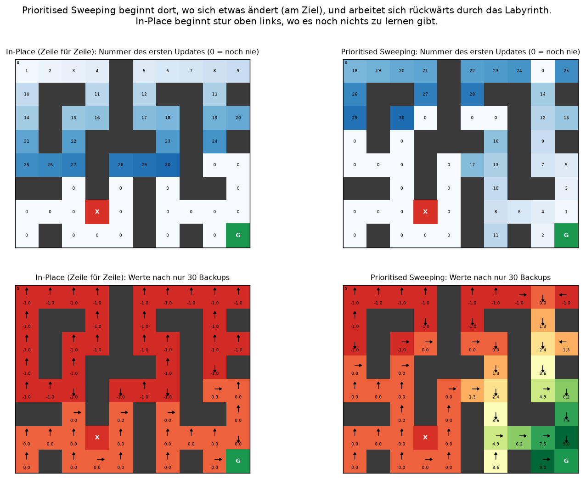

* **Oben** siehst du die Reihenfolge der ersten 30 Updates. In-place geht stur Zeile für Zeile.
  Prioritised Sweeping startet **am Ziel** und arbeitet sich **rückwärts** durchs Labyrinth.
* **Unten:** Nach nur 30 Updates hat Prioritised Sweeping schon einen Weg zum Ziel gefunden.
  In-place hat bis dahin fast nur Felder angefasst, bei denen es noch nichts zu lernen gab.
* **Trick:** Ändert sich `V(s)`, müssen nur die **Vorgänger** von `s` neu geprüft werden, denn nur sie
  benutzen `V(s)` in ihrer Formel. Eine **Prioritätswarteschlange (Heap)** liefert immer das dringendste Feld.

### 6c. Messen: Wer ist schneller?

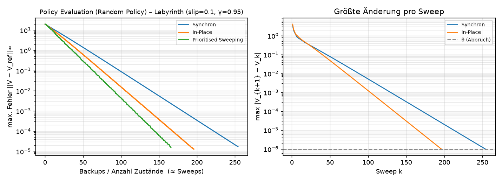

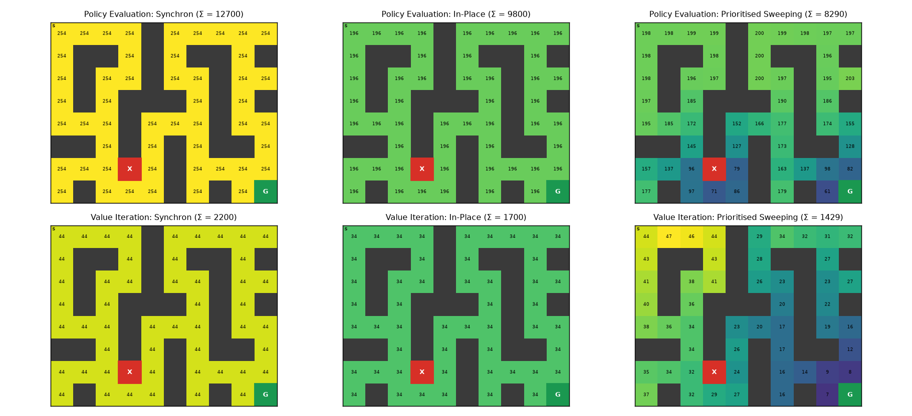

* **Fehlerkurven** (logarithmische y-Achse): Eine Gerade bedeutet, dass der Fehler jedes Mal um
  denselben Faktor schrumpft.
* **Reihenfolge nach Anzahl Updates:** Prioritised < In-Place < Synchron
  (Labyrinth: 8 290 < 9 800 < 12 700 Backups).
* **Heatmaps:** Synchron und In-Place aktualisieren **jedes Feld gleich oft**. Prioritised Sweeping
  aktualisiert **dort, wo es nötig ist**.
* **Achtung, Kosten:** Prioritised Sweeping muss zusätzlich die Bellman-Fehler der Vorgänger
  ausrechnen (33 395 Bellman-Auswertungen). Die Zahlen stehen in [`results/summary.md`](../results/summary.md).

📄 Code: [`rldp/sweeps.py`](../rldp/sweeps.py) → `run_synchronous`, `run_in_place`, `run_prioritized`

---

## 7. Policy Improvement und Policy Iteration

**In einem Satz:** Wenn ich V kenne, nehme ich in jedem Feld die Aktion mit dem besten q-Wert.
Dadurch wird die Policy nie schlechter.

```python
π = Zufall
wiederhole:
    V  = policy_evaluation(π)               # 1. Wie gut ist π?
    π' = in jedem Feld argmax_a q(s, a)     # 2. gierig verbessern
    wenn π' == π: fertig, π ist optimal
    π = π'
```

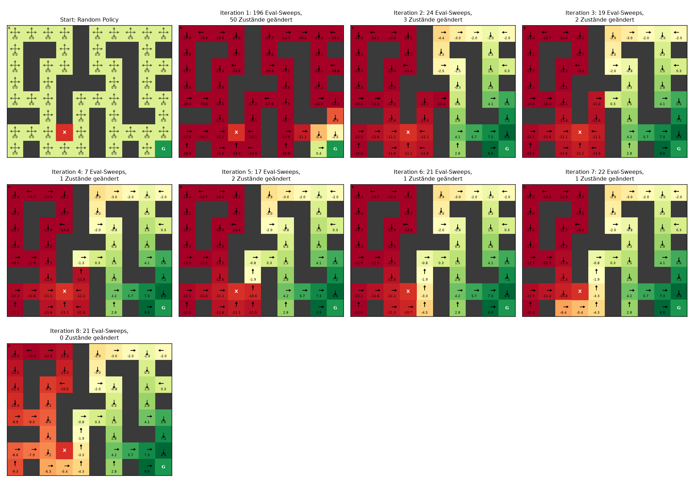

* **Warum wird es besser?** Wenn ich *einen* Schritt die bessere Aktion nehme und danach weitermache
  wie bisher, bin ich mindestens so gut wie vorher. Dasselbe gilt dann für jeden weiteren Schritt
  (Policy-Improvement-Theorem).
* **Warum hört es auf?** Es gibt nur endlich viele deterministische Policies, und keine kommt zweimal dran.
  Wenn sich nichts mehr ändert, erfüllt V die Bellman-**Optimalitäts**gleichung. Also ist π optimal.

Im Labyrinth ändert Iteration 1 alle 50 Felder, danach nur noch 3, 2, 1, … Nach 8 Iterationen ist die Policy stabil.

> 💡 **Fallstrick:** Sind zwei Aktionen gleich gut, behält man die alte. Sonst springt die Policy
> endlos hin und her und wird nie „stabil“.

📄 Code: [`rldp/improvement.py`](../rldp/improvement.py) → `policy_improvement`, `policy_iteration`

---

## 8. Value Iteration

**In einem Satz:** Statt π erst vollständig zu bewerten, nimmt man in **jedem** Sweep sofort die beste
Aktion (`max`).

```python
V = 0 überall
wiederhole:
    für jedes Feld s:
        V_neu(s) = max_a ( R(s,a) + γ · Σ_s' P(s'|s,a) · V(s') )
bis max |V_neu − V| < θ
π* = in jedem Feld argmax_a q(s, a)      # erst ganz am Ende
```

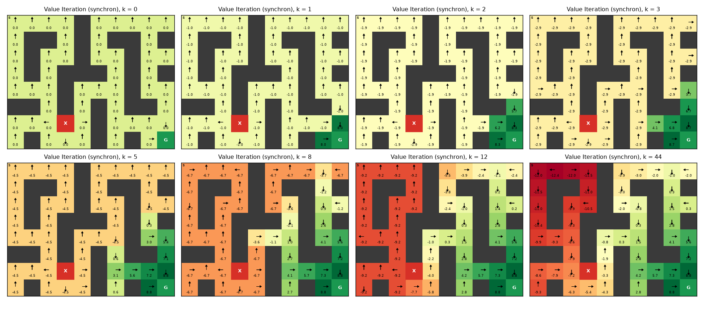

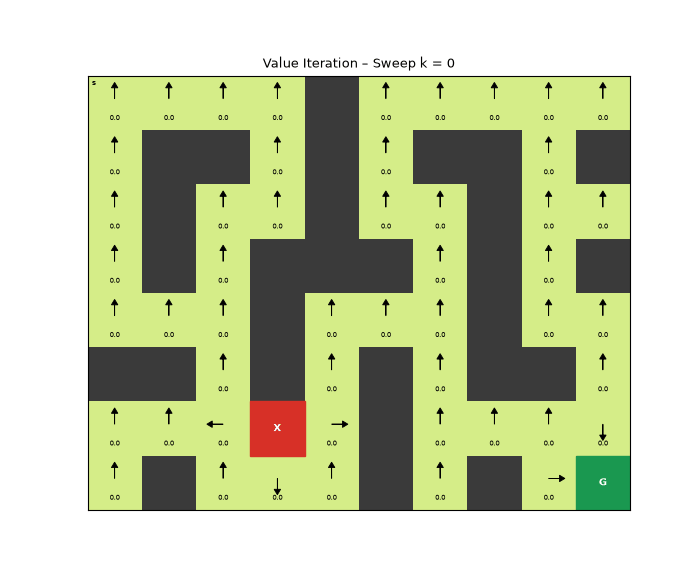

Die guten Werte **breiten sich wie eine Welle vom Ziel aus**, pro Sweep etwa ein Feld weit.
Felder, die die Welle noch nicht erreicht hat, werden langsam schlechter (−1, −1.95, −2.85, …),
weil jeder Schritt −1 kostet.

### Policy Iteration vs. Value Iteration

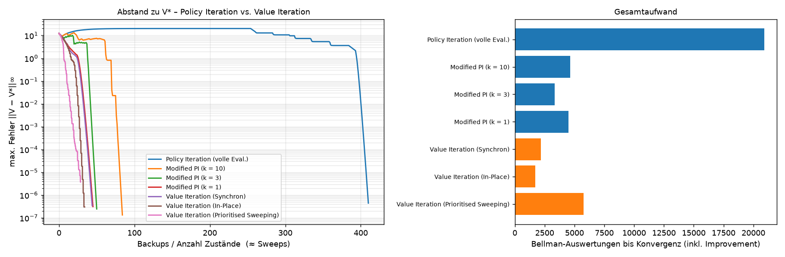

| | Policy Iteration | Value Iteration |
|---|---|---|
| Gleichung | Erwartung + greedy | Optimalität (max) |
| Policy unterwegs? | ja, explizit | nein, erst am Ende |
| Runden | **wenige** (hier 8) | **viele** (hier 44 Sweeps) |
| Kosten pro Runde | **hoch** (eine ganze Evaluation) | **niedrig** (ein Sweep) |
| Hier insgesamt | 20 900 Bellman-Auswertungen | 2 200 Bellman-Auswertungen |

Dazwischen liegt **Modified Policy Iteration**: Man bricht die Evaluation nach `k` Sweeps ab.
`k = ∞` ist Policy Iteration, `k = 1` ist praktisch Value Iteration.
Das ist die **Generalised Policy Iteration** aus den Pareigis-Folien: Evaluation und Improvement wechseln
sich ab, egal wie genau jede Phase ist.

📄 Code: [`rldp/value_iteration.py`](../rldp/value_iteration.py) → `value_iteration(env, method, theta)`

---

## 9. Warum funktioniert das immer? (Kontraktion)

**In einem Satz:** Jeder Sweep bringt **zwei beliebige** Wertetabellen mindestens um den Faktor γ näher
zusammen. Deshalb landen alle bei derselben Lösung.

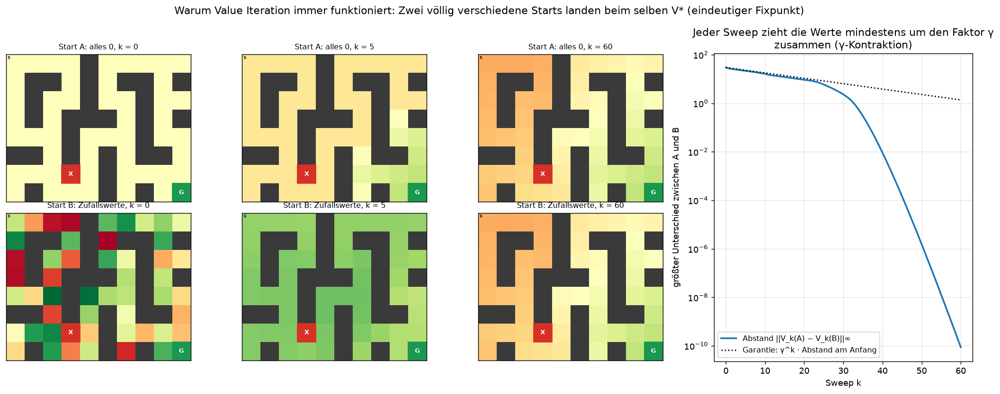

* Start A (alles 0) und Start B (wilde Zufallszahlen) sehen am Ende **gleich** aus.
* **Rechts:** Ihr Abstand fällt **mindestens** so schnell wie `γ^k` (gepunktete Linie).
* **Mathematisch:** Der Bellman-Operator ist eine **γ-Kontraktion** in der ∞-Norm
  (`max_s |U(s) − V(s)|`). Nach dem **Banachschen Fixpunktsatz** gibt es genau einen Fixpunkt
  (V^π bzw. V*), und man erreicht ihn von jedem Startpunkt aus.

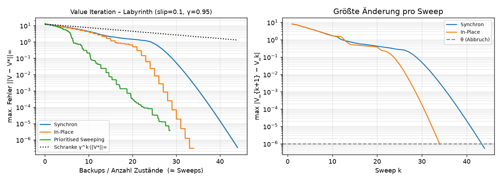

---

## 10. Stellschrauben: γ und θ

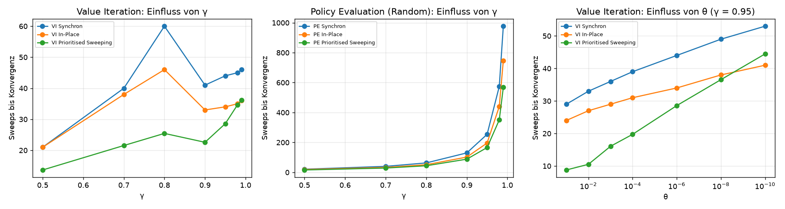

* **γ nahe 1** (weit vorausschauen): Policy Evaluation einer schlechten Policy wird **sehr langsam**,
  ungefähr wie `1/(1−γ)`. Im Labyrinth braucht sie bei γ = 0.99 schon 977 Sweeps.
* **Value Iteration** wächst viel langsamer (hier höchstens 60 Sweeps), weil die optimale Policy schnell
  im Ziel ist. Spätere Belohnungen spielen dann kaum noch eine Rolle.
* **θ kleiner** (genauer): Das kostet nur **logarithmisch** mehr Sweeps.
  Zehnmal genauer heißt nur ein paar Sweeps mehr.

---

## 11. Spickzettel

| Algorithmus | Gleichung | Update | Ergebnis |
|---|---|---|---|
| Policy Evaluation | Bellman-Erwartung | `V(s) ← Σ_a π(a\|s)[R + γΣP·V]` | V^π |
| Policy Improvement | – | `π(s) ← argmax_a [R + γΣP·V]` | besseres π |
| Policy Iteration | Erwartung + greedy | Evaluation ↔ Improvement | π*, V* |
| Value Iteration | Bellman-Optimalität | `V(s) ← max_a [R + γΣP·V]` | V*, dann π* |

| Rechenart | Merksatz |
|---|---|
| Synchron | zwei Tafeln, nur alte Werte lesen |
| In-Place | eine Tafel, frische Werte sofort nutzen. Die Reihenfolge zählt! |
| Prioritised Sweeping | größter Bellman-Fehler zuerst, danach nur die Vorgänger neu prüfen |
| Real-Time DP *(nur in den Folien)* | nur die Felder updaten, die der Agent wirklich besucht |

**Aufwand pro Sweep** (n Felder, m Aktionen): `O(m·n²)` für V und `O(m²·n²)` für q.
In sehr großen Welten ist schon ein einziger Sweep zu teuer (*Fluch der Dimensionalität*).
Dann helfen Sample-Backups, die später kommen (Monte Carlo, TD, Q-Learning).

### Typische Prüfungsfragen

<details><summary>Was ist der Unterschied zwischen Policy Evaluation und Value Iteration?</summary>

Policy Evaluation **mittelt** über die Aktionen einer festen Policy (Bellman-Erwartung) und liefert V^π.
Value Iteration nimmt das **Maximum** (Bellman-Optimalität) und liefert V*.
</details>

<details><summary>Warum braucht Value Iteration keine explizite Policy?</summary>

Das `max` wählt in jedem Backup automatisch die beste Aktion. π* liest man am Ende einmal greedy
aus V* ab. Die Zwischenwerte V_k gehören oft zu keiner echten Policy.
</details>

<details><summary>Warum endet Policy Iteration nach endlich vielen Schritten?</summary>

Jede Verbesserung macht V nie schlechter (Policy-Improvement-Theorem). Es gibt nur endlich viele
deterministische Policies, und keine kann zweimal vorkommen.
</details>

<details><summary>Wann ist In-Place besser als synchron?</summary>

Fast immer, weil frische Werte sofort weiterwirken. Am meisten bringt es, wenn die Reihenfolge der
Richtung folgt, in der sich die Information ausbreitet (vom Ziel weg). Außerdem braucht es nur eine Kopie von V.
</details>

<details><summary>Was braucht Prioritised Sweeping zusätzlich?</summary>

Es braucht die **Vorgänger** jedes Zustands (die umgekehrte Dynamik) und eine Prioritätswarteschlange.
</details>

<details><summary>Was garantiert die Konvergenz?</summary>

Die Bellman-Operatoren sind γ-Kontraktionen in der ∞-Norm. Nach dem Banachschen Fixpunktsatz gibt es
einen eindeutigen Fixpunkt, und der Fehler schrumpft mindestens wie γ^k.
</details>

---

## 12. Selbst ausprobieren

```python
import matplotlib.pyplot as plt
from rldp import GridWorld, Policy, policy_evaluation, value_iteration
from rldp.plotting import plot_values

# 1) Eigene Welt bauen
env = GridWorld(["S...#...",
                 ".#..#.#.",
                 ".#....#G"], gamma=0.9, step_reward=-1, goal_reward=10, slip=0.0)

# 2) Zufalls-Policy bewerten
pe = policy_evaluation(env, Policy.uniform(env.n_states, env.n_actions), method="in_place")

# 3) Optimale Policy suchen
vi = value_iteration(env, method="prioritized")

# 4) Anschauen
fig, axes = plt.subplots(1, 2, figsize=(12, 3))
plot_values(axes[0], env, pe.V, title=f"Zufalls-Policy ({pe.sweeps:.0f} Sweeps)")
plot_values(axes[1], env, vi.V, vi.policy, title=f"Optimal ({vi.total_backups} Backups)")
plt.show()
```

**Übungen:**

1. Setze im Labyrinth `slip=0.3` (`rldp.maps.maze`). Wie ändern sich die Pfeile neben der Falle?
   *(Tipp: Die Policy hält Abstand.)*
2. Setze `gamma=0.5`. Warum findet die Policy weit weg vom Ziel keinen sinnvollen Weg mehr?
3. Schau dir in [`experiments/didactic_figures.py`](../experiments/didactic_figures.py) die Funktion
   `corridor_sync_vs_inplace` an. Probiere eine zufällige Reihenfolge der Felder aus. Wie viele Sweeps braucht es?
4. Vergleiche `policy_iteration(env, eval_max_sweeps=k)` für k = 1, 2, 5, 20. Bei welchem k ist der Aufwand am kleinsten?
